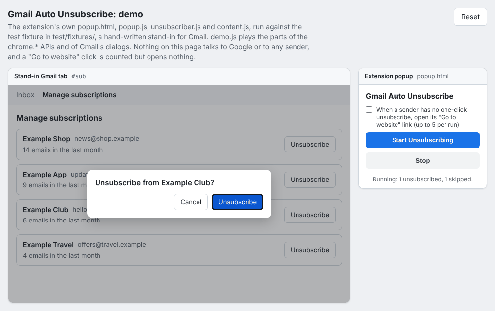
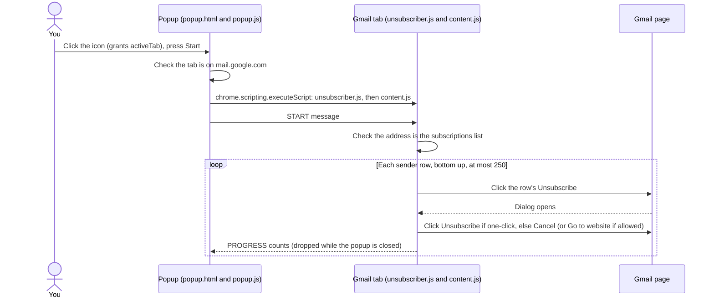
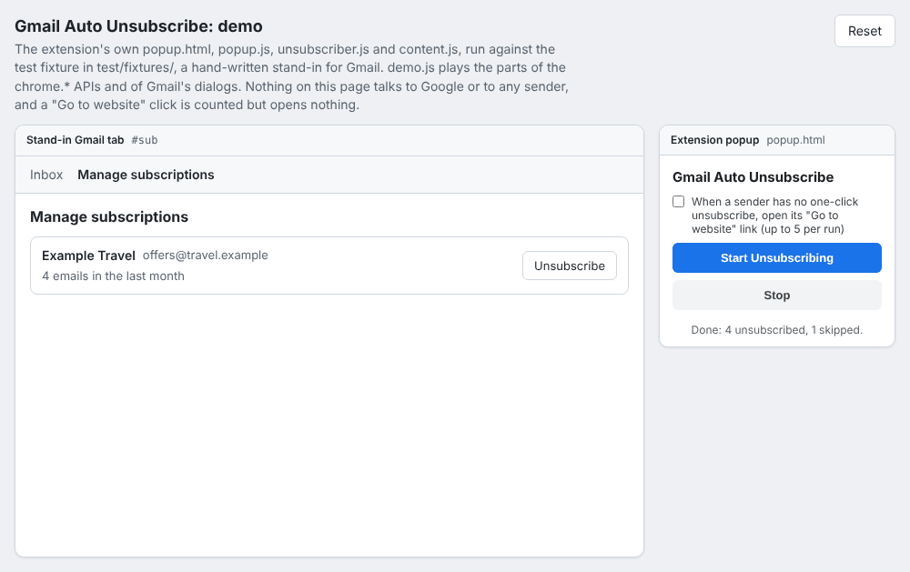
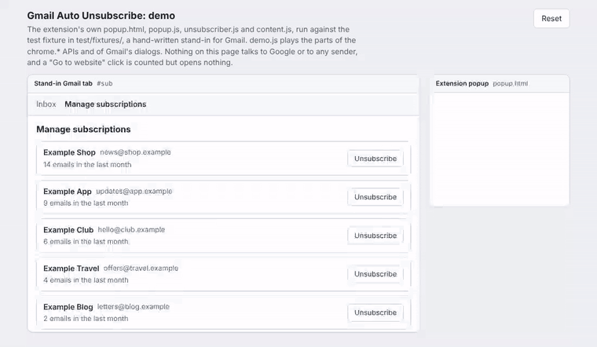

# Gmail Auto Unsubscribe

[](https://github.com/tahmidbintaslim/gmail-auto-unsubscribe/actions/workflows/ci.yml)
[](LICENSE)

A Chrome extension (Manifest V3) that works through Gmail's Manage subscriptions page for you: it clicks Unsubscribe for each sender and confirms Gmail's dialog. It uses no Gmail API, no OAuth and no server; it clicks in the Gmail tab you already have open.

**Status: prototype.** It is tested against a hand-written stand-in for Gmail's page, not yet on a live Gmail account. It has no Chrome Web Store listing; you install it with Load unpacked.



*The extension's own popup and loop, running in [`demo/`](demo/) against the hand-written test fixture. This is not real Gmail.*

> **There is no undo and no selection yet.** A run goes through every sender on the page, and the extension cannot re-subscribe you. Only press Start when you want to leave every list shown.

## Features

- One button: press **Start** in the popup and it goes down the sender list, from the bottom row up, until the list is done or you press **Stop**.
- Confirms Gmail's one-click Unsubscribe dialog. A sender without one-click unsubscribe is skipped, or, if you tick the box, sent to its own website in a new tab (at most 5 per run).
- Live counts in the popup: unsubscribed, skipped and websites opened. Closing the popup does not stop the run; open it again to see the counts.
- Bounded: at most 250 senders per press of Start, about one second between senders, and it stops as soon as the tab leaves the subscriptions list.
- Two permissions, `activeTab` and `scripting`. No host permissions, so Chrome shows no site-access warning on install.

## How it works



- `popup.js` checks the active tab and injects the two scripts only when you press Start. Nothing runs in Gmail before that.
- `unsubscriber.js` holds the loop: it finds sender rows and dialogs by their English labels, clicks, counts and enforces the limits.
- `content.js` passes Start, Stop and status messages between the popup and the loop.

## What it clicks

- It acts only in the tab you opened the popup from, and only after you press **Start**. That tab must show the Manage subscriptions list on `mail.google.com`. The check accepts an address ending in `#sub` or `#subscriptions`, optionally followed by a slash or a `?` query (Gmail adds `?compose=...` while a draft is open). Any longer hash, such as `#sub/<id>` for an open message, does not count.
- It clicks each visible **Unsubscribe** button in the sender list, starting from the bottom row. Each sender gets one try per run.
- In the dialog that opens, it clicks **Unsubscribe** when Gmail offers a one-click unsubscribe. Otherwise it clicks **Cancel** and counts the sender as skipped.
- It clicks **Go to website** only if you tick the box in the popup, and then at most 5 times per run. That opens the sender's own site in a new tab, where you finish by hand. The extension then closes the Gmail dialog with Cancel.
- It waits about a second between senders, so a long list takes a few minutes.

## When a run stops

- No sender is left that the run has not tried (**Done**).
- You press **Stop**.
- The tab leaves the Manage subscriptions list, for example when you open a message or the inbox.
- 250 senders in one run. Press **Start** again to continue with the rest.
- A Gmail dialog stays open after Unsubscribe. The run stops instead of guessing.
- An unexpected error, or the extension is reloaded or removed.

## What it never does

- It never opens, reads, moves, labels or deletes your email. On the Manage subscriptions page it reads button and link labels, the text of sender rows, the tab's address and the address of a link it is about to follow, nothing else.
- It never runs on a tab you did not open the popup from, or on any site other than `mail.google.com`.
- It never clicks the Unsubscribe link inside a message. It checks the address before every click and stops once you leave the subscriptions view.
- It confirms a dialog only right after opening it from a sender's row. A dialog that is open when the run moves to the next sender gets Cancel: one that was open before you pressed Start, or one Gmail showed after the run stopped waiting for it (about 3 seconds).
- It clicks Cancel only inside a dialog, or next to an Unsubscribe or Go to website button. It leaves any other Cancel button on the page alone.
- It never sends data anywhere, stores anything, or loads code from the internet.

## Privacy and account access

**No Gmail API, no OAuth, no tokens.** The extension requests no Google API scopes, so there is no Google Cloud project, OAuth client or consent screen to set up, and nothing appears under third-party access in your Google account. It holds no password, token or API key. It acts through the Gmail tab you are already signed in to, the same way your own clicks would, and it does not read cookies.

What it reads, and when:

| Data | When | What it is used for |
| --- | --- | --- |
| The active tab's address | When you open the popup, on Start or Stop, and before each click during a run | Checking the host is `mail.google.com` (popup) and the hash is the subscriptions list (Gmail tab) |
| Text and `aria-label` of visible buttons and links | During a run, in the Gmail tab | Finding Unsubscribe, Cancel and Go to website |
| The text of each sender row (name, address, Gmail's count line) | During a run, in the Gmail tab | Telling rows apart, so each sender is tried once per run |
| The address of a link clicked in the Gmail tab | During a run | Stopping a click from following a sender's link to its messages or a search |

Where it lives: run counts and the row text above stay in memory in the Gmail tab and are gone when the tab reloads. Nothing is written to disk, to `chrome.storage` or to web storage.

What leaves your browser because of this extension: the extension itself sends nothing. The clicks it makes cause Gmail to send unsubscribe requests and, if you allow it, open senders' websites.

- No network requests: no `fetch`, XMLHttpRequest, WebSocket, EventSource or beacon calls, and no analytics.
- No background service worker, no remote code, no account or server.
- The only messages are between the popup and the Gmail tab, inside Chrome. On an unexpected error it writes one line to the Gmail tab's DevTools console.

`test/manifest.test.js` fails if `manifest.json`, `popup.html`, `popup.js`, `unsubscriber.js` or `content.js` contains `fetch`, XMLHttpRequest, WebSocket, EventSource, `sendBeacon`, `chrome.storage`, web storage or IndexedDB, `eval` or `new Function`, or an `http(s)://` URL. It is a pattern check, not a proof.

What Gmail and senders see is the same as if you clicked yourself: when the extension confirms Unsubscribe, Gmail handles the request to the sender. If you allow Go to website, the sender's site opens in a new tab and sees a normal visit.

To remove all of its access, remove the extension on `chrome://extensions`.

## Permissions

| Permission | Why it is needed |
| --- | --- |
| `activeTab` | Clicking the extension icon gives it temporary access to that one tab. The popup uses it to read the tab's address (to check that it is Gmail's Manage subscriptions view) and to run the clicker there. The access ends when that tab navigates away or closes. |
| `scripting` | Injects `unsubscriber.js` and `content.js` into that Gmail tab when you press Start. Nothing runs in Gmail before that. |

There are no host permissions, no content scripts declared in the manifest, and no `tabs`, `storage` or background permissions, so Chrome shows no site-access warning when you install it.

## Install (Load unpacked)

Requires Google Chrome or another Chromium browser with Manifest V3 support.

1. Clone this repository, or download it (Code, then Download ZIP) and unzip it.
2. Open `chrome://extensions` in Chrome.
3. Turn on **Developer mode** (top right).
4. Click **Load unpacked** and select the folder that contains `manifest.json`.
5. Optional: pin the extension from the puzzle-piece menu so its icon stays in the toolbar.

There is no build step: Chrome loads the source files as they are. You do not need `npm install` to use the extension; that is only for running the tests.

## Use

1. Open Gmail in Chrome and go to **Manage subscriptions** in the left menu (Gmail may list it under **More**). If your account does not show that page, the extension has nothing to work on.
2. Click the extension icon, then **Start Unsubscribing**.
3. Leave the Gmail tab alone while it runs. Press **Stop** at any time.

The extension matches Gmail's English labels (Unsubscribe, Cancel, Go to website). With Gmail set to another language it finds nothing to click.

## Try the demo (no Gmail needed)

[`demo/`](demo/) runs the extension's own `popup.html`, `popup.js`, `unsubscriber.js` and `content.js` in two frames, against the hand-written fixture in `test/fixtures/`. `demo/demo.js` stands in for Chrome's extension APIs and for Gmail's dialogs. One sender only offers Go to website, so a run shows both outcomes. The page makes no requests outside the local server, and a Go to website click is counted but opens nothing.

It fetches files, so serve the repository root over HTTP instead of opening the file directly. One command, no dependencies beyond Node:

```bash
npm run demo        # serves the repo on http://localhost:8000 (PORT=... to change)
# or: python3 -m http.server 8000
```

Then open <http://localhost:8000/demo/> and press **Start Unsubscribing**. **Reset** reloads the list.



A full run, recorded with Playwright from `npm run demo` (15 seconds):



Hosted copy: [gmail-auto-unsubscribe-demo.vercel.app](https://gmail-auto-unsubscribe-demo.vercel.app) (the same page, served by Vercel from `vercel.json`, with `/` going to `/demo/`). It is the stand-in demo, not Gmail.

The demo is a way to watch the loop, not evidence that it works on real Gmail: it uses the same stand-in markup as the tests.

## Tech stack

- Chrome extension, Manifest V3, plain JavaScript. The shipped files are classic scripts with no runtime dependencies and no bundler, because `chrome.scripting` cannot inject modules.
- Chrome APIs: `chrome.scripting.executeScript`, `chrome.tabs.query` and `chrome.tabs.sendMessage`, `chrome.runtime` messaging.
- Tests: [Vitest](https://vitest.dev/) 5 with [jsdom](https://github.com/jsdom/jsdom) 29.
- CI: GitHub Actions on Node 22 and 24. Dependabot opens grouped weekly updates for npm and GitHub Actions.

## Development

Prerequisites: Node.js 22 (22.13 or later) or 24, with npm. Chrome for the manual test.

```bash
git clone https://github.com/tahmidbintaslim/gmail-auto-unsubscribe.git
cd gmail-auto-unsubscribe
npm ci
npm test
```

There is nothing to build and no environment variables or `.env` file: the extension has no configuration, keys or secrets. After changing a file, click the reload icon on the extension's card in `chrome://extensions`.

The tests run the extension's own files in jsdom against `test/fixtures/`, a hand-written, anonymized stand-in for Gmail's Manage subscriptions page and its dialogs. It is not a capture of Gmail, so passing tests do not prove the extension works on the real page. They cover one-click senders, website-only senders, an empty list, the 250-sender cap, lists Gmail re-renders, leaving the page mid-run, Stop, dialogs that do not close or open late, the popup flow with a stubbed `chrome` API, and the manifest's permissions.

CI ([`.github/workflows/ci.yml`](.github/workflows/ci.yml)) runs `npm ci` and `npm test` on Node 22 and 24 for every push and pull request to `main`.

## Project structure

```text
manifest.json         Permissions (activeTab, scripting) and the popup
popup.html, popup.js  Start, Stop and the status line; injects the scripts on Start
unsubscriber.js       The loop: finds rows and dialogs, clicks, counts, enforces limits
content.js            Message bridge between the popup and the loop
test/                 Vitest + jsdom tests; fixtures/ holds the stand-in Gmail markup
demo/                 Browser demo of the real files against the fixtures (not shipped)
scripts/serve-demo.mjs  Dependency-free local server for the demo (npm run demo)
docs/images/          README screenshots, captured from demo/
```

## Deployment

Not published. The extension is installed with Load unpacked from a clone of `main`; there is no Chrome Web Store listing, release package or hosted service. Before any listing, the name would need checking against Google's branding rules for the word "Gmail".

## Manual test on real Gmail

Testing on real Gmail is still manual. Use a test account with a few newsletters if you can, and work through this list after any change:

- [ ] Load unpacked shows no errors for the extension on `chrome://extensions`.
- [ ] On a site other than Gmail, Start shows "Open Gmail first."
- [ ] On the Gmail inbox, Start shows "Open Gmail's Manage subscriptions page first."
- [ ] On the Manage subscriptions list, the address ends in `#sub`. If it is anything else, Start refuses to run there; note the address so the check can be updated.
- [ ] With a one-click sender in the list, Start unsubscribes it, its row leaves the list and the popup count goes up.
- [ ] A sender whose dialog offers only Go to website, with the box unticked: the dialog closes with Cancel, the sender counts as skipped, and its dialog opens only once.
- [ ] The same sender with the box ticked: one new tab opens for it and the Gmail dialog closes. No more than 5 tabs open in one run.
- [ ] Stop during a run: no clicks after the current sender.
- [ ] Opening a message during a run: the run stops with "left the subscriptions page" and nothing in the message is clicked.
- [ ] Closing and reopening the popup during a run: the counts are still shown.
- [ ] An empty list: Start reports Done with zero counts.
- [ ] A long list: senders Gmail loads as you scroll are processed. This is not verified yet; if some are missed, note it and press Start again.
- [ ] Save an anonymized copy of the real page and both dialog types to `test/fixtures/` to replace the hand-written ones.

## Status and roadmap

Prototype. The loop, its limits and the popup are covered by tests against stand-in markup; nothing has been verified on a live Gmail account yet.

Next: run the [manual checklist](#manual-test-on-real-gmail) on a real account and replace the hand-written fixtures with an anonymized capture of the real page. Not started: a preview or keep-list so a run can skip senders, and labels for Gmail languages other than English.

## Limitations

- English Gmail interface only.
- It depends on Gmail's page markup, which Google can change at any time.
- No preview, selection or keep-list: every sender on the page is processed.
- Not affiliated with or endorsed by Google. Gmail is a trademark of Google LLC.

## Contributing

Issues and pull requests are welcome. Please keep the extension's surface as it is: no new permissions, network calls or storage without a clear reason in the pull request. Run `npm test` before opening one, and if you change what the loop clicks, add a test with a fixture and update this README.

## License

[MIT](LICENSE) © 2026 Tahmid Bin Taslim Rafi
